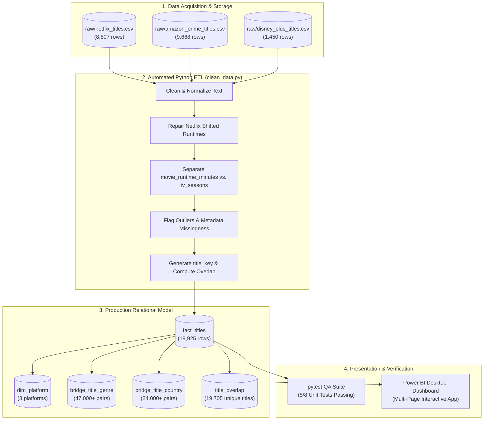

# 🎬 Binge-Metrics: Movie & OTT Platform Content Analysis

<p align="center">
  
  
  
  
  
</p>

---

## 📌 Executive Summary
**Binge-Metrics** is an end-to-end Data Science and Business Intelligence project conducting an empirical catalogue inventory analysis of three leading streaming providers: **Netflix**, **Amazon Prime Video**, and **Disney+**.

Rather than relying on unverified public dashboards with hard-coded schemas, this project was architected from the ground up to demonstrate production-grade data engineering:
- **Reproducible Data Pipeline:** Automated ingestion, regex-based anomaly repair, and schema validation.
- **Relational Star Schema:** Normalized bridge tables to handle multi-valued genres and countries without duplication.
- **Automated QA Testing Suite:** 8 comprehensive unit tests written in `pytest` enforcing 100% row preservation.
- **Interactive Power BI Dashboard:** Dark cinematic executive design with calibrated DAX measures and cross-platform exclusivity analysis.

---

## 🏗️ System Architecture



---

## 📊 Key Findings & Empirical Statistics

| Dimension / Metric | Netflix | Amazon Prime Video | Disney+ | Combined / Overall |
| :--- | :---: | :---: | :---: | :---: |
| **Total Inventory (Titles)** | **8,807** | **9,668** | **1,450** | **19,925** |
| **Feature Films (Movies)** | 6,131 (69.6%) | 7,814 (80.8%) | 1,052 (72.6%) | **14,997 (75.3%)** |
| **Episodic Series (TV Shows)** | 2,676 (30.4%) | 1,854 (19.2%) | 398 (27.4%) | **4,928 (24.7%)** |
| **Median Movie Runtime** | **98.0 min** | **94.0 min** | **83.0 min** | — |
| **Average TV Series Seasons** | 1.76 seasons | 1.25 seasons | 2.12 seasons | — |
| **Unique Content Titles** | — | — | — | **19,705 distinct keys** |
| **Cross-Platform Exclusivity** | — | — | — | **19,485 exclusive (98.9%)** |
| **Titles Shared Across Services**| — | — | — | **220 shared (1.1%)** |

### 🔍 Key Insights:
1. **Library Strategy:** Amazon Prime Video prioritizes volume-based movie licensing (80.8% Movies). Netflix leads in episodic programming (30.4% TV Shows) designed for recurring monthly subscriber retention.
2. **Animation Effect on Runtime:** Disney+'s median movie runtime is noticeably shorter (**83 minutes**) compared to Netflix (**98 minutes**), directly reflecting its core catalog of animated family features.
3. **The "Streaming Wars" Content Boom:** More than 75% of content across all three libraries was produced between **2015 and 2021**, peaking during the height of original production investments.
4. **Content Silos:** 98.9% of all streaming titles are completely exclusive to a single provider. Only 220 titles appear simultaneously on more than one service (194 on Netflix & Prime, 26 on Netflix & Disney+, 6 on Prime & Disney+, and 0 on all three).

---

## 🛠️ Data Quality Audit & Cleaning Decisions

### 1. Shifted Rows Repair (Netflix)
Three comedy specials (`s5542 Louis C.K. 2017`, `s5795 Louis C.K.: Hilarious`, `s5814 Louis C.K.: Live at the Comedy Store`) had runtime strings (`74 min`, `84 min`, `66 min`) placed in the `rating` column while `duration` was blank.  
* **Engineering Solution:** Extracted the runtime into `duration` and `movie_runtime_minutes`, setting `rating` to verifiable `NULL`. No synthetic ratings were fabricated.

### 2. Preserving Real-World Missingness (Amazon Prime)
* **The Problem:** Amazon Prime metadata is missing **98.4% of `date_added`** and **93.0% of `country`**.
* **Engineering Solution:** Rows were not discarded. Explicit quality flags (`date_added_missing_flag`, `country_missing_flag`) were created, and missing fields were displayed cleanly as `"Unknown"`.

### 3. Duration Dimension Separation
* Movie runtimes (`movie_runtime_minutes`) and TV season counts (`tv_seasons`) are stored in distinct numeric columns and **never cross-contaminated**.
* 85 anomalous $\le 5$-minute records were isolated with `suspicious_short_runtime_flag` to protect median runtime metrics without discarding raw records.

---

## 📁 Repository Structure

```
├── data/
│   ├── raw/                           # Original unedited Kaggle CSVs (Netflix, Prime, Disney+)
│   └── processed/                     # Clean Star-Schema CSVs (fact_titles, bridges, overlap)
├── docs/                              # Comprehensive Academic Documentation
│   ├── README.md                      # Detailed technical documentation
│   ├── viva_preparation.md            # Complete student viva defense & model answers
│   ├── methodology_and_findings.md     # In-depth statistical analysis & scope boundaries
│   ├── measures.md                    # DAX formulas, filter contexts & pair-count caveats
│   └── licensing_and_sources.md       # Open-source licensing & data attribution
├── powerbi/
│   ├── OTT_Content_Analysis_Dashboard_Clean.pbix  # ⭐ Interactive Power BI Report
│   ├── theme/                         # Custom Dark & Executive theme JSON files
│   └── POWER_BI_SETUP_GUIDE.md        # Step-by-step model setup & DAX checklist
├── reports/
│   └── data_quality/                  # Data quality audit log (100% row preservation)
├── screenshots/                       # High-resolution reference charts (Composition, Trends, Overlap)
├── src/
│   ├── pipeline/clean_data.py         # One-command automated Python cleaning pipeline
│   └── analysis/                      # Independent ground-truth metrics & chart generator
├── tests/
│   └── test_pipeline_and_quality.py    # Automated QA pytest suite (8/8 tests passing)
├── requirements.txt                   # Minimal dependencies (pandas, matplotlib, pytest)
└── .gitignore
```

---

## 🚀 Reproduction & Execution Guide

### 1. Clone & Set Up Environment
```bash
git clone https://github.com/Satvik-Parihar/Binge-Metrics.git
cd Binge-Metrics
pip install -r requirements.txt
```

### 2. Execute Data Pipeline
Run the reproducible cleaning and star-schema generator:
```bash
python src/pipeline/clean_data.py
```
*Output: Generates clean tables in `data/processed/` and logs all actions in `reports/data_quality/`.*

### 3. Run Automated QA Tests
Verify data integrity across all 19,925 records:
```bash
pytest -v tests/test_pipeline_and_quality.py
```
*Result: 8/8 unit tests pass in ~1.5 seconds.*

### 4. Open the Power BI Dashboard
Double-click `powerbi/OTT_Content_Analysis_Dashboard_Clean.pbix` in Power BI Desktop to explore the interactive visual analytics.

---

## 🔒 Scope & Ethical Boundaries
- **Catalogue Inventory vs. Popularity:** This project performs an inventory composition analysis. It makes **no claims** regarding viewership, audience size, box office revenue, or market share. A larger catalog (e.g. Prime's 9,668 titles) reflects licensing volume, not consumer preference or platform superiority.
- **Data Provenance:** Datasets represent historical library snapshots ending in late 2021 (compiled by Shivam Bansal on Kaggle).

---

## 👤 Author
**Satvik Parihar**  
*Final Year (Semester 7) Individual Data Science Project*  
*Bachelor of Technology in Computer Science & Engineering*  
*Repository:* [Satvik-Parihar/Binge-Metrics](https://github.com/Satvik-Parihar/Binge-Metrics)

